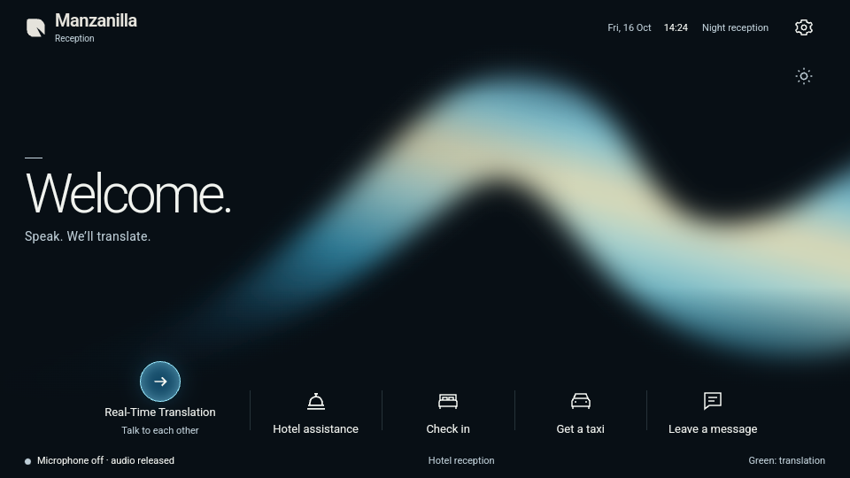
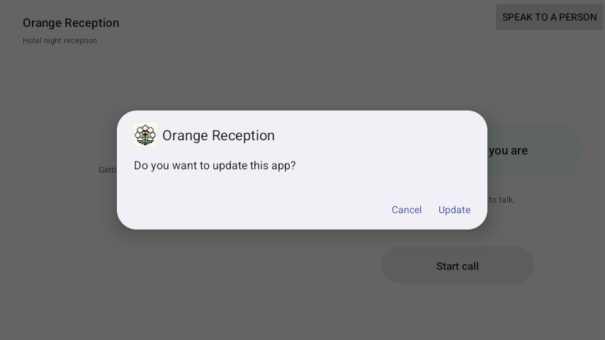

# Manzanilla

**Faster execution hardware for the hospitality industry.**

Manzanilla Reception is a landscape Android app with an open-canvas reception home, navy appearance options and hands-free live translation. Reception and guest languages have independent 52-language selectors. A prerecorded guest-language greeting plays before the microphone opens. Ordinary APKs contain no provider account key; staff can save an encrypted device key after Android credential authentication, or use a configured managed backend. An explicitly opted-in keyed pilot embeds a Fish key for immediate testing and is extractable, not production-safe. Previously saved Gemini keys remain supported.


<p align="center">
  <a href="https://github.com/somdipto/manzanilla/releases/latest/download/Manzanilla-Reception.apk"></a>
  &nbsp;
  <a href="https://github.com/somdipto/manzanilla/releases"></a>
</p>

## Install

1. On the Android device, open this link and download the APK: **[Manzanilla-Reception.apk (latest)](https://github.com/somdipto/manzanilla/releases/latest/download/Manzanilla-Reception.apk)**
2. Open the downloaded file. If Android asks, allow "Install unknown apps" for the browser or file manager you used, then tap Install.
3. Open **Manzanilla**. It starts straight on reception, without staff enrollment. Use the staff-setup gear to configure Fish Audio if this device has no saved voice key.

<p align="center"></p>

All releases: https://github.com/somdipto/manzanilla/releases

## Update an existing installation

Open Manzanilla while connected to the internet. The app checks the GitHub release feed on resume and downloads newer APKs in the background. Tap the update offer, then approve Android's install prompt. Do not uninstall: an in-place update keeps app data and saved keys. The update-check interval depends on the installed version; 17.0.4 checks at most once every ten minutes.

For a manual update, open the latest APK link above and install it over the existing app. If Android requests permission, allow Manzanilla or your browser to install unknown apps.

Publication uses the semantic version in `android/VERSION` and the explicit increasing integer in `android/VERSION_CODE`. Every candidate must preserve package `dev.orange.hotel` and the existing signing certificate, supersede the last published version code, and pass artifact identity/digest checks. Verification builds are key-free; only an explicitly requested keyed-pilot release embeds `FISH_API_KEY` (see `docs/ENVIRONMENT.md`). Failed download/validation attempts are cleared so retry can discover a replacement release; an active download remains pinned to its immutable identity.

<p align="center">
  
</p>

Android may require an "Update" confirmation for an app installed from a file; this is not a silent remote installation.

## Screens

Every reception screen, original and current, is listed in [docs/screens](docs/screens/README.md).

## What is in this repository

| Folder | What it is |
| --- | --- |
| `android/hotel` | The Manzanilla Reception app (landscape, microphone, auto-update) |
| `android/app` | Earlier general-purpose controller app, kept for reference |
| `cloud` | Backend for hotel setup, device sessions and voice calls |
| `admin` | Small web dashboard for hotel setup |
| `edge`, `infra`, `shared` | Supporting services and shared definitions |
| `docs` | Architecture, pilot deployment notes, test plan |
| `.github/workflows` | CI: build, test and publish releases |

The original hand-off notes are kept in [docs/HANDOFF-README.md](docs/HANDOFF-README.md).

## Status

17.0.7 refines the approved open-canvas reception design: compact language selectors show the selected language without repeated names or keypad numbers; conversation bubbles use neutral charcoal/gray surfaces in dark mode and warm gray in light mode. Starting translation plays the app's bundled guest-language welcome before microphone capture, with guest-language text above receptionist-language text in one divided reception-side bubble. This welcome is app-owned, not generated by the voice agent.

Linked captions render guest-left/receptionist-right, with original speech above its opposite-language translation. **Current Fish/Gemini feeds do not supply reliable original/translation associations; their unlinked captions remain separate.** The renderer is verified with linked synthetic events, not claimed as solved live pairing. Hotel assistance still requires the configured backend and real hotel integrations.

Verification: 31 Android JVM tests, Android lint, debug and signed release assembly passed locally. Isolated browser checks covered readable selectors at small landscape sizes, all 52 welcome language pairs, neutral-bubble contrast, stale events and greeting history across restart. A disposable native Android fixture exercised actual bundled welcome playback in English, Japanese and Arabic, player release, and immediate cancellation without opening a microphone or provider connection. All 52 bundled WAV files were validated. No additional paid calls ran. The explicitly authorized pilot still embeds an extractable Fish key. Muted emulator playback is not physical speaker or live full-duplex proof; detailed evidence and prior benchmarks are in [artifacts/VERIFICATION.md](artifacts/VERIFICATION.md).

Conversation screenshots from the actual Android WebView use **injected synthetic captions, not live speech**: [dual bubbles](docs/screens/17.0.6-conversation-fixture.png), [stopped state](docs/screens/17.0.6-stopped-fixture.png).

## Build it yourself

Requires JDK 17 and the Android SDK.

```sh
cd android
./gradlew :hotel:assembleDebug
```

Signed release builds are produced by GitHub Actions; the signing key is stored as a repository secret and is never committed.

## License

See [LICENSE](LICENSE).
