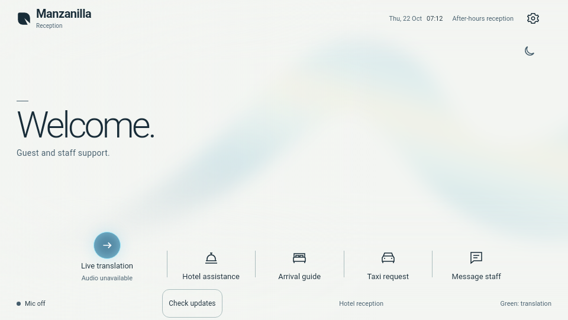
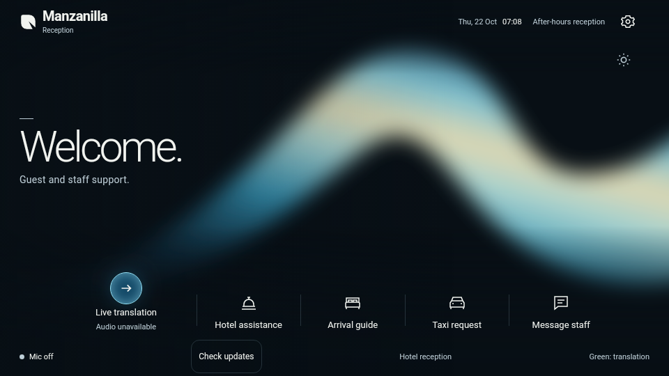
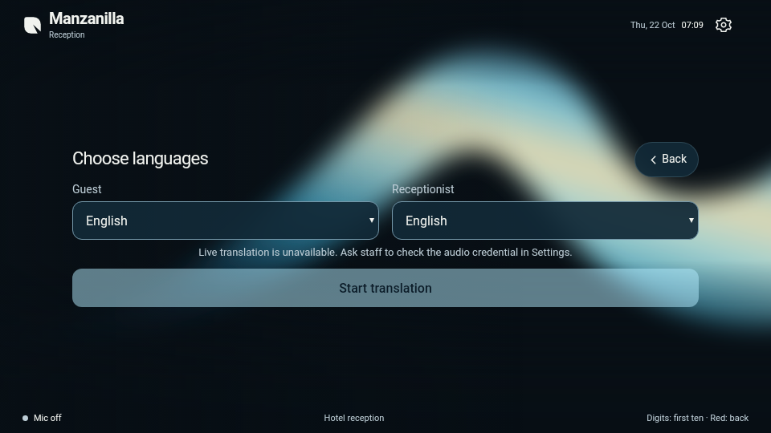
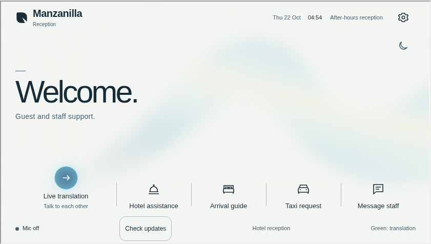
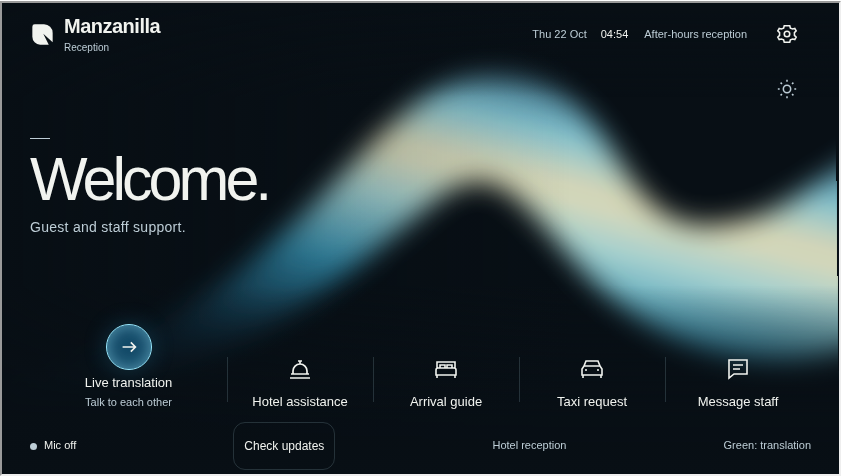

# Manzanilla

**Faster execution hardware for the hospitality industry.**

Manzanilla Reception is a landscape Android app with an open-canvas reception home, day/night appearance and hands-free live translation. Reception and guest languages have independent selectors. The published 17.0.37 testing APK contains an extractable shared Fish credential at the owner's request; use a disposable, account-limited key and rotate it after testing. The repair candidate separates personal testing from enrolled hotel use; it is not a qualified hotel deployment.

<p align="center">
  <a href="https://github.com/somdipto/manzanilla/releases/latest/download/Manzanilla-Reception.apk"></a>
  &nbsp;
  <a href="https://github.com/somdipto/manzanilla/releases"></a>
</p>

Direct download: **[Manzanilla-Reception.apk](https://github.com/somdipto/manzanilla/releases/latest/download/Manzanilla-Reception.apk)**

All releases: https://github.com/somdipto/manzanilla/releases

## Install

1. On the Android device, open this link and download the APK: **[Manzanilla-Reception.apk (latest)](https://github.com/somdipto/manzanilla/releases/latest/download/Manzanilla-Reception.apk)**
2. Open the downloaded file. If Android asks, allow "Install unknown apps" for the browser or file manager you used, then tap Install.
3. Open **Manzanilla**. It starts straight on reception, without staff enrollment. Use the staff-setup gear for the hotel service.

<p align="center"></p>

## Update an existing installation

The 17.0.31 candidate requires a PR and increasing version files for app changes. After the user merges an eligible PR, **Publish verified Reception APK** runs source and emulator checks, signs with the existing key, checks a retained-data upgrade and verifies draft assets before publishing. The update becomes available only when publication succeeds.

Open Manzanilla while connected to the internet. Every app resume checks immediately; an open foreground app also rechecks every ten minutes. Version 17.0.30 requires the downloaded update action. The 17.0.31 candidate applies verified downloads when reception is idle and asks Android 12+ for unattended installation when eligible. Android can still require source permission or an installation confirmation. In-place replacement keeps app data and saved keys; it can stop the process, so unattended kiosk recovery requires a tested managed launcher or EMM policy.

Older installed versions through 17.0.7 can suppress checks for ten minutes after a recent attempt and hide discovery errors. If that prevents this repair from arriving, perform a **one-time manual in-place update** using the latest APK link above. Allow your browser to install unknown apps if requested, and choose **Update**, not uninstall.

Publication uses the semantic version in `android/VERSION` and the explicit increasing integer in `android/VERSION_CODE`. Every candidate must preserve package `dev.orange.hotel` and the existing signing certificate, supersede the last published version code, and pass artifact identity/digest checks. Verification builds are key-free. Failed download/validation attempts are cleared so retry can discover a replacement release; an active download remains pinned to its immutable identity.

<p align="center">
  
</p>

<p align="center">
  
</p>

Android may require an "Update" confirmation for an app installed from a file; this is not a silent remote installation. Installed apps update from a newer signed GitHub Release, not from a source push or an Actions build artifact.

## Distribution and readiness — repair candidate

Build property `distribution` is `personal-test` by default, or `hotel`. Debug
builds honor the chosen behavior but always compile empty provider fields.
Personal testing keeps PIN-free Fish setup, encrypted saved-key precedence over
the bundled fallback, an explicit direct preference over enrollment and its
one-click update offer. A bundled testing key is labelled extractable.

Hotel new translation starts use only the enrolled managed connection. Existing
personal keys are retained, not shown or erased; original hash-fenced cleanup
can still use its original credential. The hotel gear and voice-setup path both
require Android device-credential confirmation. Enrollment, appearance,
after-hours controls, updates and diagnostics stay in protected native setup.
Credential replacement is refused while original voice cleanup is outstanding.

An enrolled connection is configured, not automatically connected. A private
authenticated heartbeat has a three-second deadline, refreshes on resume and
every25 foreground seconds, and becomes stale after30 seconds. Guest actions
show availability before entry; native admission also enforces it. These flags
describe configuration, not paid provider entitlement or somebody watching the
inbox. Independent direct personal translation remains usable when hotel
operations are unavailable. Uncertain submitted requests retain their exact
reconciliation identity.

All52 interface locales remain selectable and visibly human-unreviewed.
Distribution-specific feeds and signed installation proof remain separate S7
gates. Do not deploy hotel builds before those gates and voice qualification.

## Approved hotel answers — repair candidate

The repair candidate answers hotel questions only with staff-approved renderings
for the guest's selected interface language. Existing knowledge and arrival text
remain stored, but are not automatically approved or labelled as English.

Use the admin content-review panel to select the original and target language,
edit a draft or enter reviewed text manually, then explicitly approve its exact
title and body. Gemini can draft translations for review and select approved
fact references; it cannot invent guest-facing policies or execute hotel actions.
Manual approval remains usable when drafting is unavailable.

Editing a source or approved rendering withdraws stale information receipts.
The guest can ask again or choose reception help; an unanswered question never
creates a ticket automatically. New information requests can see new approvals,
while replaying the same request identity performs no model call. Durable taxi,
message and escalation receipts retain their original content and write identity.
Arrival guidance never completes check-in. Deploy this backend before clients
that depend on approved-content capabilities.

## Screens

17.0.28 candidate on an actual Android10 emulator with stock WebView74.
Key-free functional checks; no live conversation or latency measurement.

<p align="center">
  
  
  
</p>


17.0.27 candidate: real day/night palettes and repaired reception controls.
These are isolated synthetic browser captures, **not native-device or live-audio evidence**.

<p align="center">
  
  
</p>


17.0.26 language-attribution fixture: consecutive German receptionist utterances
stay right; French guest speech goes left. This is a synthetic browser capture,
not a live microphone or physical-device result.

<p align="center"></p>

17.0.21 release-source fixtures: exact original speech and assistant output remain explicitly unlinked; “Unspecified” does not guess who spoke. Microphone-off, recording and unknown states remain visible. These are synthetic browser captures, **not live speech or physical-device audio proof**.

<p align="center"></p>

Earlier language selection and microphone-off assistance:

<p align="center"></p>

<p align="center"></p>

Historical translation-state captures:

<p align="center"></p>

<p align="center"></p>

Every reception screen, original and current, is listed in [docs/screens](docs/screens/README.md).

## What is in this repository

The **17.0.31 candidate** repairs translation startup and LiveKit cleanup,
starts microphone capture during the worker greeting, avoids repeated PCM
padding, and restores the verified in-place updater and PR release safeguards.
The [local synthetic comparison](docs/verification/livekit-synthetic-2026-10-27.txt)
shows the previous worker missed microphone input during the greeting while the
candidate handled an interruption over a real local LiveKit server. Real Fish
voice naturalness, physical-device interruption and acoustic latency remain
unmeasured. Backend/worker deployment is separate from APK publication.

| Folder | What it is |
| --- | --- |
| `android/hotel` | The Manzanilla Reception app (landscape, microphone, auto-update) |
| `cloud` | Backend for hotel setup, device sessions and voice calls |
| `admin` | Small web dashboard for hotel setup |
| `edge`, `infra`, `shared` | Supporting services and shared definitions |
| `docs` | Architecture, pilot deployment notes, test plan, screens |
| `.github/workflows` | CI: build, test and publish releases |

The original hand-off notes are kept in [docs/HANDOFF-README.md](docs/HANDOFF-README.md).

## Status

**17.0.27 translation/reception candidate (unreleased):** translation text is
requested before caption generation, Android audio diagnostics run off the media
callback, and unused raw transcript copying is removed. Fixed the APK's blocked
language script, real light/dark palettes, preference navigation, native setup
appearance, and note review/edit/retry/cancel behavior. Managed `language-v2`
retains separate legacy v1/tool-free contracts; deploy the backend before the APK.
[Investigation, architecture, device-test needs and limitations](docs/realtime-reception-fix.md).

The latest public APK checked on 2026-10-22 is **17.0.24**. The 17.0.25 recognition
and playout improvements and newer source fixes are not installed by pulling or
merging source. A signed GitHub Release is required. No physical speech-latency
improvement or sub-second result is claimed for this candidate.


**17.0.26 language-side candidate (unreleased):** the interpretation model sends
one display-only caption report containing its source-language decision, original
speech and translation. Receptionist language maps right, guest language maps
left, and unclear language retains the preceding side. No turn alternation or
text-language guesses remain. Managed clients opt into `language-v1`; deploy the
backend before upgrading those devices. [Contract, research and acceptance checks](docs/language-bubble-fix.md).

**17.0.25 latency candidate (unreleased):** per-session recognition now uses
Nova-3 only when both selected languages support Fish's hosted multilingual
switching; all other pairs retain Scribe. Expressive delivery and the provider's
three-second opening speech-drop guard are disabled, and Android requests
WebRTC's low-latency playback mode with echo cancellation/noise suppression kept.
Gemini 3.8 Flash, Fish S2.1 Pro and the reception screens stay in place.
[Research, changes and device verification](docs/voice-latency-fix.md).
Physical speech-to-speech improvement is not yet measured; this source change
does not update installed devices until a signed release is published.

17.0.21 separates local audio release from paid-session cleanup, retains uncertain ownership, removes guessed caption associations, and updates individual caption bubbles instead of rebuilding the conversation. Startup failures now acknowledge the proposed session; restored reservations that never dispatched can recover without bypassing genuinely uncertain creation. Managed backends distinguish proven non-creation from lost responses. Refusing an update during a conversation keeps the update action retryable. The models, voice and endpointing settings are unchanged. The offline acoustic tool is `tools/voice_latency.py`; physical speech-to-speech latency and bilingual accuracy qualification remain blocked on an isolated matching tablet/capture setup and confirmed remaining spending authorization. See [verification](artifacts/VERIFICATION.md) and [reproduction instructions](docs/TEST-PLAN.md).

17.0.13 enabled live translation through the Fish interpreter route and embedded a CI credential at the time. Current releases do not embed that shared key. A staff-saved device credential or a configured hotel service is required. The unused device-side Gemini route and legacy managed relay are removed. Provider usage is billed to the owner's provider account. Physical-device echo, latency and full-duplex behavior remain unverified.

17.0.10 keeps hotel assistance usable with the microphone off: arrival guidance, hotel questions, taxi requests, confirmed staff messages and human-contact options. Missing hotel configuration stays unavailable. A saved inbox receipt is not staff acknowledgement.

17.0.8 repairs update discovery: app resume no longer skips checks because of a persisted cooldown; offline/discovery errors are visible and retryable; a home-screen check control and foreground rechecks make updates reachable without restarting or reinstalling the app.

17.0.7 refines the approved open-canvas reception design: compact language selectors show the selected language without repeated names or keypad numbers; conversation bubbles use neutral charcoal/gray surfaces in dark mode and warm gray in light mode. Starting translation plays the app's bundled guest-language welcome before microphone capture, with guest-language text above receptionist-language text in one divided reception-side bubble. This welcome is app-owned, not generated by the voice agent.

The current caption path maps the model-reported source language to the selected guest/receptionist language and carries original plus translation in one report. **Fish transcript segment IDs still do not identify translation pairs; raw SDK transcripts are used only for transport diagnostics.** Earlier clients retain their unlinked caption protocol. Hotel assistance still requires the configured backend and real hotel integrations.

Earlier verification: 31 Android JVM tests, Android lint, debug and signed release assembly passed locally. Isolated browser checks covered readable selectors at small landscape sizes, all 52 welcome language pairs, neutral-bubble contrast, stale events and greeting history across restart. A disposable native Android fixture exercised actual bundled welcome playback in English, Japanese and Arabic, player release, and immediate cancellation without opening a microphone or provider connection. All 52 bundled WAV files were validated. Muted emulator playback is not physical speaker or live full-duplex proof. Detailed evidence is in [artifacts/VERIFICATION.md](artifacts/VERIFICATION.md).

Earlier captures: [compact language selection](docs/screens/17.0.7-languages.png) and [app-owned bilingual welcome](docs/screens/17.0.7-welcome-fixture.png). The welcome fixture exercises bundled audio and its native playback event, not a live provider session. Earlier ordinary-conversation captures use **injected synthetic captions, not live speech**: [dual bubbles](docs/screens/17.0.6-conversation-fixture.png), [stopped state](docs/screens/17.0.6-stopped-fixture.png).

## Build it yourself

Requires JDK 17 and the Android SDK.

```sh
cd android
./gradlew :hotel:assembleDebug
```

Signed release builds are produced by GitHub Actions. The signing key is stored as a repository secret and is never committed.

## License

See [LICENSE](LICENSE).
