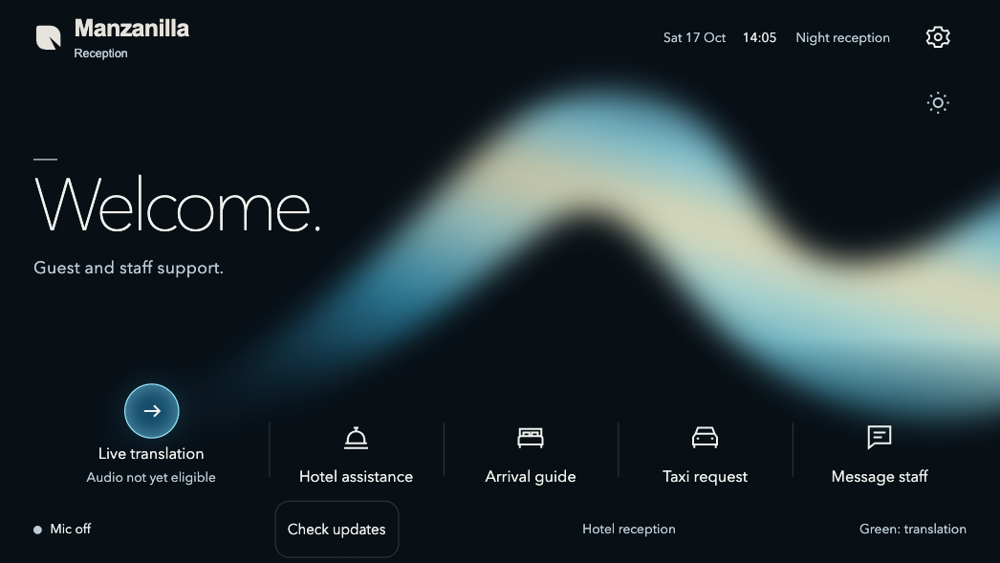
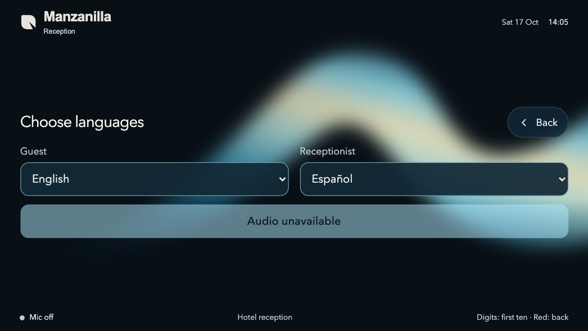
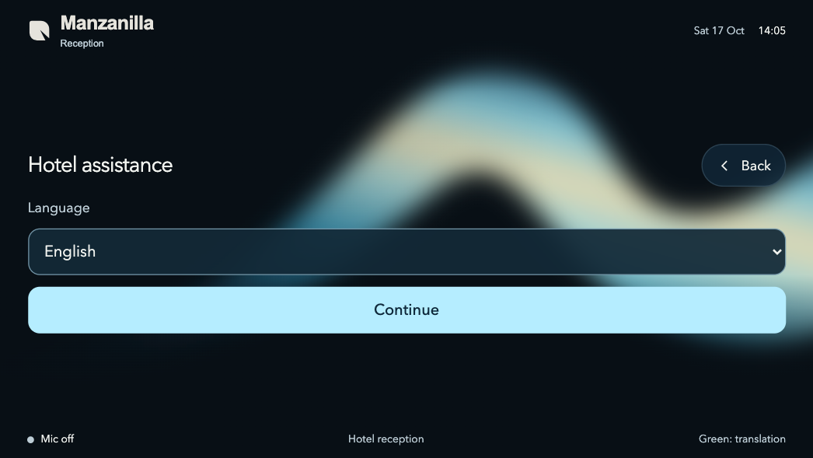

# Manzanilla

**Faster execution hardware for the hospitality industry.**

Manzanilla Reception is a landscape Android app for guests and hotel staff. The home screen offers live translation, hotel assistance, arrival guidance, taxi requests, and staff messages. The English greeting line is “Hey, hi, how are you doing?”

<p align="center">
  <a href="https://github.com/somdipto/manzanilla/releases/latest/download/Manzanilla-Reception.apk"></a>
  &nbsp;
  <a href="https://github.com/somdipto/manzanilla/releases"></a>
</p>

## How the app looks

These are the current screens, rendered at a 6-inch landscape size. They are not a live hotel conversation.

<p align="center"></p>

<p align="center"></p>

<p align="center"></p>

<p align="center"></p>

<p align="center"></p>

Every reception screen, including older releases, is listed in [docs/screens](docs/screens/README.md).

## Install

1. On the Android device, open **[Manzanilla-Reception.apk (latest)](https://github.com/somdipto/manzanilla/releases/latest/download/Manzanilla-Reception.apk)**.
2. Open the downloaded file. If Android asks, allow installation from this source, then tap Install.
3. Open **Manzanilla**. Use the staff-setup gear for the hotel service. No provider account key is embedded in the APK.

## Update an existing installation

Open Manzanilla while connected to the internet. Tap **Check updates**. Tap the downloaded update, allow installation if Android asks, then approve the system **Update** prompt. Do not uninstall. An in-place update keeps app data and saved credentials.

<p align="center"></p>

<p align="center"></p>

The published download is still 17.0.10 until the next signed release. The screens above are the current source, not that published APK.

## What is in this repository

| Folder | What it is |
| --- | --- |
| `android/hotel` | The Manzanilla Reception app |
| `cloud` | Hotel operations backend |
| `admin` | Hotel setup and inbox |
| `edge`, `infra`, `shared` | Supporting interfaces |
| `docs` | Screens, deployment notes, and configuration |
| `.github/workflows` | Build, test, and signed release |

## Build

Requires JDK 17 and Android SDK 34.

```sh
cd android
./gradlew :hotel:assembleDebug
```

Signed release builds run in GitHub Actions. The signing key stays in repository secrets and is never committed.

## License

See [LICENSE](LICENSE).
