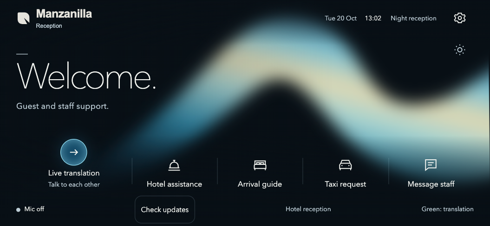
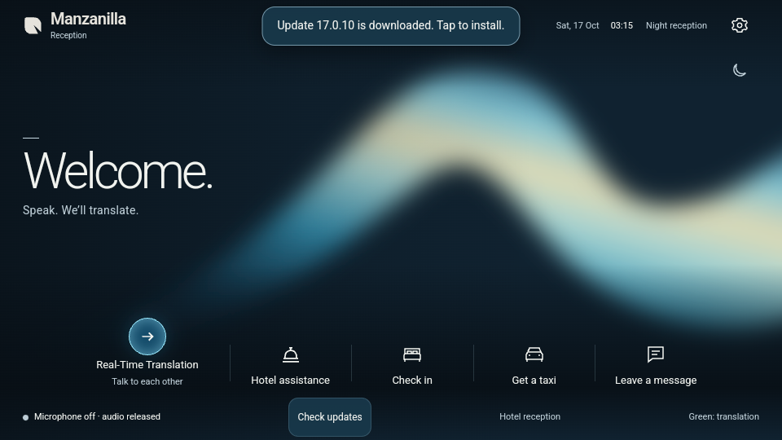
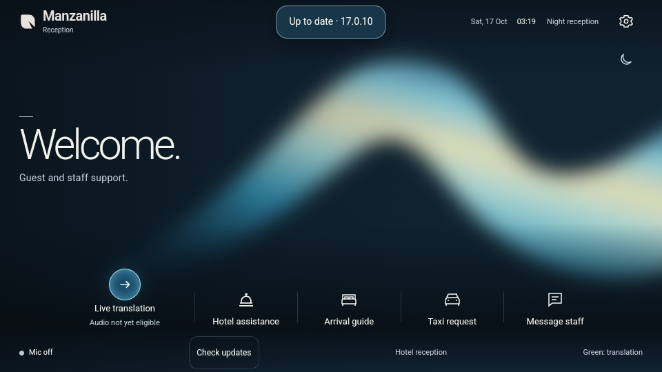
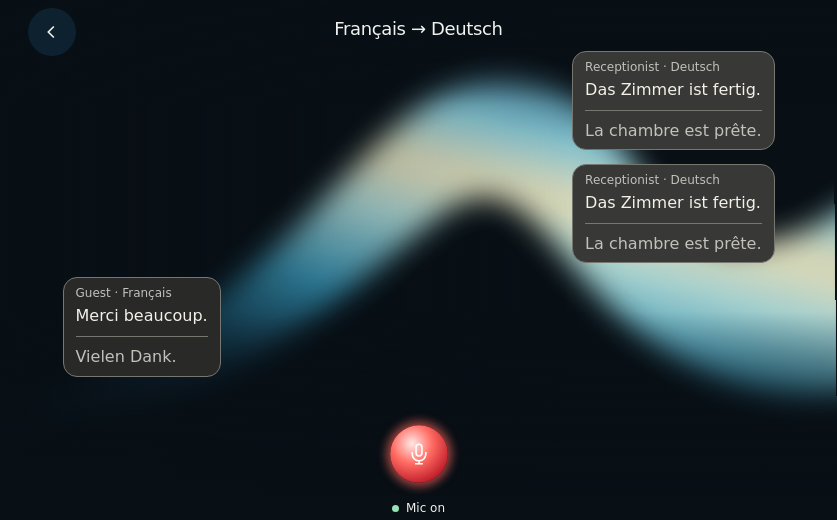
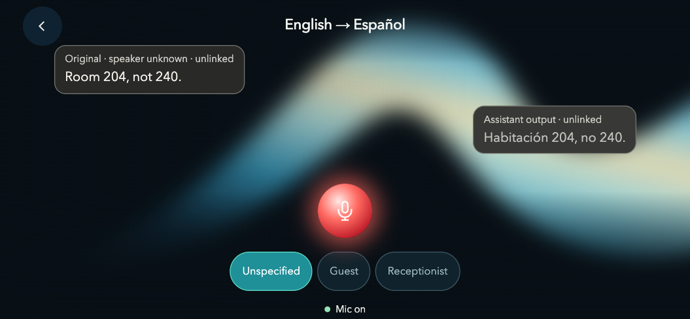
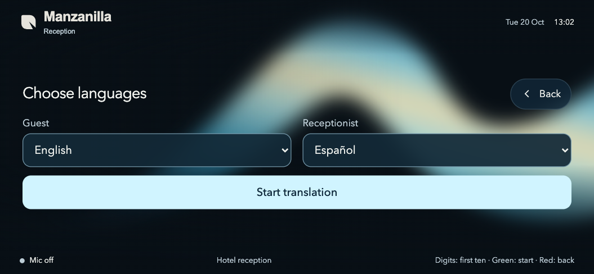
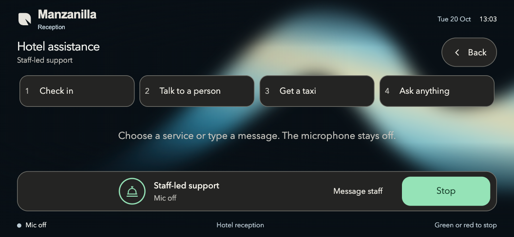
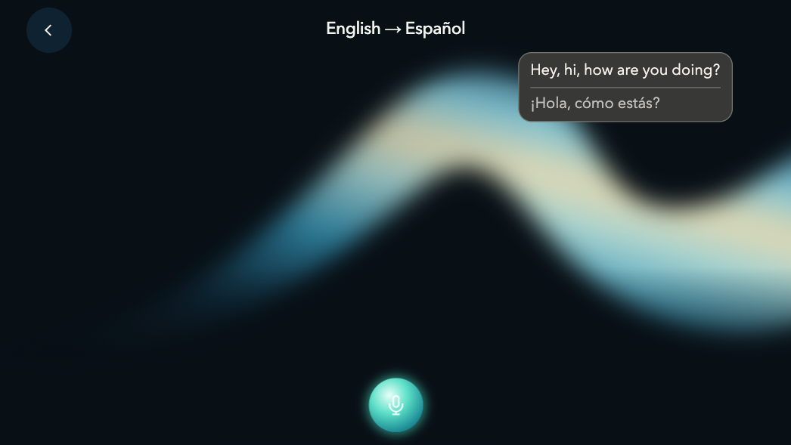
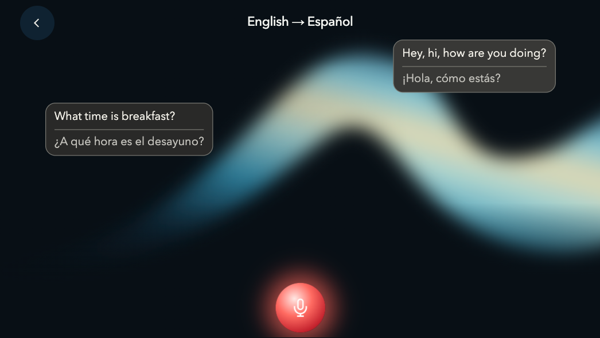

# Manzanilla

**Faster execution hardware for the hospitality industry.**

Manzanilla Reception is a landscape Android app with an open-canvas reception home, navy appearance options and hands-free live translation. Reception and guest languages have independent selectors. Fish provides the configured opening greeting within its voice session; there is no local greeting-WAV capture gate. A configured hotel backend keeps its provider key server-side. **The current public release APK includes an extractable CI-injected provider key**; encrypted device storage does not protect a key compiled into an APK.

<p align="center">
  <a href="https://github.com/somdipto/manzanilla/releases/latest/download/Manzanilla-Reception.apk"></a>
  &nbsp;
  <a href="https://github.com/somdipto/manzanilla/releases"></a>
</p>

Direct download: **[Manzanilla-Reception.apk](https://github.com/somdipto/manzanilla/releases/latest/download/Manzanilla-Reception.apk)**

All releases: https://github.com/somdipto/manzanilla/releases

## Install

1. On the Android device, open this link and download the APK: **[Manzanilla-Reception.apk (latest)](https://github.com/somdipto/manzanilla/releases/latest/download/Manzanilla-Reception.apk)**
2. Open the downloaded file. If Android asks, allow "Install unknown apps" for the browser or file manager you used, then tap Install.
3. Open **Manzanilla**. It starts straight on reception, without staff enrollment. Use the staff-setup gear for the hotel service.

<p align="center"></p>

## Update an existing installation

Open Manzanilla while connected to the internet. From 17.0.8, every app resume checks immediately; an open foreground app also rechecks every ten minutes. The home screen's **Check updates** button retries immediately. The banner shows checking, download progress, a downloaded update, an up-to-date version, or a retryable failure instead of silently hiding discovery errors. Tap the downloaded update, allow installation if Android asks, then approve Android's install prompt. Do not uninstall: an in-place update keeps app data and saved keys.

Older installed versions through 17.0.7 can suppress checks for ten minutes after a recent attempt and hide discovery errors. If that prevents this repair from arriving, perform a **one-time manual in-place update** using the latest APK link above. Allow your browser to install unknown apps if requested, and choose **Update**, not uninstall.

Publication uses the semantic version in `android/VERSION` and the explicit increasing integer in `android/VERSION_CODE`. Every candidate must preserve package `dev.orange.hotel` and the existing signing certificate, supersede the last published version code, and pass artifact identity/digest checks. Verification builds are key-free. Failed download/validation attempts are cleared so retry can discover a replacement release; an active download remains pinned to its immutable identity.

<p align="center">
  
</p>

<p align="center">
  
</p>

Android may require an "Update" confirmation for an app installed from a file; this is not a silent remote installation. Installed apps update from a newer signed GitHub Release, not from a source push or an Actions build artifact.

## Screens

17.0.26 language-attribution fixture: consecutive German receptionist utterances
stay right; French guest speech goes left. This is a synthetic browser capture,
not a live microphone or physical-device result.

<p align="center"></p>

17.0.21 release-source fixtures: exact original speech and assistant output remain explicitly unlinked; “Unspecified” does not guess who spoke. Microphone-off, recording and unknown states remain visible. These are synthetic browser captures, **not live speech or physical-device audio proof**.

<p align="center"></p>

Earlier language selection and microphone-off assistance:

<p align="center"></p>

<p align="center"></p>

Historical translation-state captures:

<p align="center"></p>

<p align="center"></p>

Every reception screen, original and current, is listed in [docs/screens](docs/screens/README.md).

## What is in this repository

| Folder | What it is |
| --- | --- |
| `android/hotel` | The Manzanilla Reception app (landscape, microphone, auto-update) |
| `cloud` | Backend for hotel setup, device sessions and voice calls |
| `admin` | Small web dashboard for hotel setup |
| `edge`, `infra`, `shared` | Supporting services and shared definitions |
| `docs` | Architecture, pilot deployment notes, test plan, screens |
| `.github/workflows` | CI: build, test and publish releases |

The original hand-off notes are kept in [docs/HANDOFF-README.md](docs/HANDOFF-README.md).

## Status

**17.0.26 language-side candidate (unreleased):** the interpretation model sends
one display-only caption report containing its source-language decision, original
speech and translation. Receptionist language maps right, guest language maps
left, and unclear language retains the preceding side. No turn alternation or
text-language guesses remain. Managed clients opt into `language-v1`; deploy the
backend before upgrading those devices. [Contract, research and acceptance checks](docs/language-bubble-fix.md).

**17.0.25 latency candidate (unreleased):** per-session recognition now uses
Nova-3 only when both selected languages support Fish's hosted multilingual
switching; all other pairs retain Scribe. Expressive delivery and the provider's
three-second opening speech-drop guard are disabled, and Android requests
WebRTC's low-latency playback mode with echo cancellation/noise suppression kept.
Gemini 3.8 Flash, Fish S2.1 Pro and the reception screens stay in place.
[Research, changes and device verification](docs/voice-latency-fix.md).
Physical speech-to-speech improvement is not yet measured; this source change
does not update installed devices until a signed release is published.

17.0.21 separates local audio release from paid-session cleanup, retains uncertain ownership, removes guessed caption associations, and updates individual caption bubbles instead of rebuilding the conversation. Startup failures now acknowledge the proposed session; restored reservations that never dispatched can recover without bypassing genuinely uncertain creation. Managed backends distinguish proven non-creation from lost responses. Refusing an update during a conversation keeps the update action retryable. The models, voice and endpointing settings are unchanged. The offline acoustic tool is `tools/voice_latency.py`; physical speech-to-speech latency and bilingual accuracy qualification remain blocked on an isolated matching tablet/capture setup and confirmed remaining spending authorization. See [verification](artifacts/VERIFICATION.md) and [reproduction instructions](docs/TEST-PLAN.md).

17.0.13 enables live translation through the Fish interpreter route. The release build compiles the CI-injected Fish credential; a staff-saved credential overrides it on one device; a configured hotel service mints managed sessions instead, which requires the service-side FISH_API_KEY. The unused device-side Gemini route and the legacy managed relay are removed; there is no provider fallback or automatic switching. Provider usage is billed to the owner's provider account. Physical-device echo, latency and full-duplex behavior remain unverified.

17.0.10 keeps hotel assistance usable with the microphone off: arrival guidance, hotel questions, taxi requests, confirmed staff messages and human-contact options. Missing hotel configuration stays unavailable. A saved inbox receipt is not staff acknowledgement. Live translation runs through the owner-approved Fish route with the CI-injected credential.

17.0.8 repairs update discovery: app resume no longer skips checks because of a persisted cooldown; offline/discovery errors are visible and retryable; a home-screen check control and foreground rechecks make updates reachable without restarting or reinstalling the app.

17.0.7 refines the approved open-canvas reception design: compact language selectors show the selected language without repeated names or keypad numbers; conversation bubbles use neutral charcoal/gray surfaces in dark mode and warm gray in light mode. Starting translation plays the app's bundled guest-language welcome before microphone capture, with guest-language text above receptionist-language text in one divided reception-side bubble. This welcome is app-owned, not generated by the voice agent.

The current caption path maps the model-reported source language to the selected guest/receptionist language and carries original plus translation in one report. **Fish transcript segment IDs still do not identify translation pairs; raw SDK transcripts are used only for transport diagnostics.** Earlier clients retain their unlinked caption protocol. Hotel assistance still requires the configured backend and real hotel integrations.

Earlier verification: 31 Android JVM tests, Android lint, debug and signed release assembly passed locally. Isolated browser checks covered readable selectors at small landscape sizes, all 52 welcome language pairs, neutral-bubble contrast, stale events and greeting history across restart. A disposable native Android fixture exercised actual bundled welcome playback in English, Japanese and Arabic, player release, and immediate cancellation without opening a microphone or provider connection. All 52 bundled WAV files were validated. Muted emulator playback is not physical speaker or live full-duplex proof. Detailed evidence is in [artifacts/VERIFICATION.md](artifacts/VERIFICATION.md).

Earlier captures: [compact language selection](docs/screens/17.0.7-languages.png) and [app-owned bilingual welcome](docs/screens/17.0.7-welcome-fixture.png). The welcome fixture exercises bundled audio and its native playback event, not a live provider session. Earlier ordinary-conversation captures use **injected synthetic captions, not live speech**: [dual bubbles](docs/screens/17.0.6-conversation-fixture.png), [stopped state](docs/screens/17.0.6-stopped-fixture.png).

## Build it yourself

Requires JDK 17 and the Android SDK.

```sh
cd android
./gradlew :hotel:assembleDebug
```

Signed release builds are produced by GitHub Actions. The signing key is stored as a repository secret and is never committed.

## License

See [LICENSE](LICENSE).
