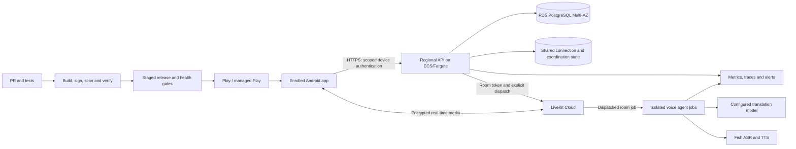

# Production architecture for reception voice and updates

This is a proposed target, not a deployed service. The current backend uses a
local SQLite ledger and process-local connection state; the voice worker polls
rooms and must run as a single replica. The direct-distribution updater in
17.0.31 requests unattended replacement where Android permits it. None of those
facts establishes a capacity or security guarantee for a hotel fleet.

## Recommended managed design

Use **LiveKit Cloud** for real-time media and explicit agent dispatch, and
**AWS** for the hotel backend, PostgreSQL, secrets and operational telemetry.
Start with one region close to the first hotels and multi-AZ infrastructure;
add regions only after measuring actual demand, residency requirements and cost.
This recommendation requires organization-owned accounts, a domain, a chosen
region, deployment credentials and a spending limit. No resources are created by
this document.

LiveKit's [agent dispatch](https://docs.livekit.io/agents/server/agent-dispatch/)
assigns a job to an available agent server; use explicit dispatch and verify
capacity, retries and room isolation. LiveKit Cloud also offers
[managed agent deployment](https://docs.livekit.io/deploy/agents/). Choose
either that deployment or controlled AWS agent hosts after a cost and latency
comparison; do not run both as competing owners of the same room. The current
polling worker must be adapted to this contract before multiple replicas run.

Put stateless HTTP/WebSocket API tasks behind a TLS application load balancer.
Use private network access to PostgreSQL, encryption at rest, managed backups,
restore drills and least-privilege service roles. RDS Multi-AZ provides database
failover, not a multi-region active-active design. Use a managed cache or message
bus only for the shared connection and coordination functions actually needed;
PostgreSQL remains the durable source of truth. Replace every process-local
ticket, edge connection and pending-operation assumption before adding API
replicas. Qualify reconnection and failover rather than relying on sticky routing.

## Identity, room ownership and revocation

1. Enroll each tablet to one hotel using a short-lived staff-authorized setup
   flow. Issue a unique, revocable device credential; keep the administrator
   credential and all provider keys off the APK. Store device credentials in
   Android Keystore-backed storage. Scope every server read/write to hotel and
   device; test cross-hotel denial and credential rotation.
2. Move sessions, quotas, route identity, idempotency keys and cleanup state to
   transactional PostgreSQL. Atomically reserve one room/job per device request,
   persist an outbox for uncertain creates and ends, and reconcile after worker
   or API failure. Scope every retry to the original request and tenant.
3. Issue short-lived, room-scoped LiveKit credentials only after checking device
   authorization. On revocation, stop issuing new tokens and remove the relevant
   participant using a tested explicit revocation cutoff. LiveKit Cloud's
   [revocation behavior](https://docs.livekit.io/frontends/reference/tokens-grants/)
   includes a finite revocation window and refresh semantics: set token lifetime
   accordingly, never reuse old room identities, and test reconnect and replay.
   Do not treat a short JWT expiry or DeleteRoom alone as immediate revocation.
4. Keep provider keys in a managed secret store, grant only the worker/provider
   calls it requires, and rotate any credential embedded in prior public APKs.
   Avoid guest speech, transcripts, credentials and tokens in ordinary logs.
   Define retention, deletion, access, regional residency and incident response
   before real guest use; encryption does not replace those controls.

## Delivery from PR to devices

- Require PR checks and an explicit increasing package version for Android
  changes. Build immutable backend/worker images and a signed APK from the merge
  commit. Use workload identity/OIDC for short-lived CI permissions rather than
  long-lived cloud credentials. Test database migrations, signing continuity,
  retained app data and rollback against isolated fixtures before publishing.
- Deploy backend and agent images by digest to staging with a synthetic hotel and
  synthetic provider endpoints. Test session creation, concurrent devices,
  cancellation, lost responses, room cleanup, revoked-token replay and failover.
  Promote the same digests to a small cohort, then expand automatically only while
  measured health and rollback thresholds remain acceptable. Drain active voice
  sessions during deployment. APK publication and backend/worker deployment are
  separate gates; one does not imply the other.
- Keep `dev.orange.hotel` and the currently installed signing certificate. For
  personal Android devices, use Google Play once the app has a compliant Play
  variant and the existing app-signing identity has been preserved; Play update
  timing depends on its policies and user/device settings. For hotel-owned
  tablets, enroll devices in Android Enterprise and use managed Play plus a
  tested kiosk/default-home relaunch policy. Provisioning and store enrollment
  are one-time organization/device setup, not an app-code toggle.
- Existing direct installs need an initial in-place update to 17.0.31. Its
  future self-updates are best effort: Android may require install-source or
  system approval, and process replacement may require a relaunch. Neither the
  direct updater nor CI can disable Play Protect or guarantee a silent install.

## Ordered implementation and acceptance

1. **Choose ownership and budget.** Establish accounts, domain, region, data
   retention rules, provider concurrency limits and a monthly cost ceiling. Set
   billing alerts and per-hotel/account usage guardrails before a live pilot.
2. **Harden the contracts.** Add PostgreSQL migrations, durable cleanup,
   device enrollment, tenant isolation and explicit LiveKit agent dispatch in
   separately reviewed PRs. Test duplicate requests, unknown outcomes,
   revocation, interrupted deployments, process crashes and restore procedures.
3. **Build the deployment lane.** Add infrastructure-as-code, isolated staging,
   short-lived CI cloud identity, immutable image promotion and observable
   canary/rollback controls. Document exact ownership, version compatibility,
   secret rotation and a higher-version Android recovery procedure.
4. **Qualify the voice experience.** On the actual tablet and network, compare
   old and new routes with the same language pairs, voice, model and scripted
   utterances. Record p50/p95 end-of-speech to audible translated speech,
   interruption/echo results and blinded listening ratings. Establish baseline
   and acceptance thresholds before claiming speed or naturalness improvements.
5. **Roll out gradually.** Start with a small consenting cohort, watch session
   success, update success, provider latency, failures, revocation and spend,
   and expand only after the observed results justify it. Thousands of installed
   apps are not evidence of thousands of concurrent voice sessions; load-test
   the expected concurrency and provider quotas explicitly.

Useful platform references: [LiveKit agent server](https://docs.livekit.io/agents/server/),
[LiveKit token revocation](https://docs.livekit.io/frontends/reference/tokens-grants/),
[ECS load balancing](https://docs.aws.amazon.com/AmazonECS/latest/developerguide/service-load-balancing.html),
[RDS Multi-AZ](https://docs.aws.amazon.com/AmazonRDS/latest/UserGuide/Concepts.MultiAZ.html),
and [managed Play update policies](https://developers.google.com/android/management/control-app-updates).
