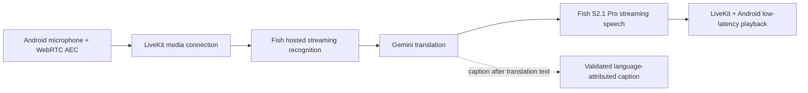

# Translation and reception repair — 17.0.27 candidate

Base: `b1835c1` (latest `main` fetched on 2026-10-22). Candidate version 17.0.27,
code 57, Fish configuration revision 14. This is a PR candidate, not a published
APK or a claim of measured sub-second translation.

## What explains the gap

The latest public GitHub release checked during this investigation is
[17.0.24](https://github.com/somdipto/manzanilla/releases/tag/v17.0.24), built from
`8b7c006b53598f275b73c171a6d44b5f646f923d`. The improvements merged for 17.0.25
and 17.0.26 have not reached that download. An installed APK's version must be
recorded before comparing it with current source or a Fish web/telephone call.

| Finding | Scope and consequence |
| --- | --- |
| Recognition and playback improvements are unreleased | 17.0.24 lacks the language-aware Nova-3 selection, explicit low-latency Android playout, plain expressive setting and opening echo-guard change already merged for 17.0.25. Fish's documented ASR-finalization difference is about 0.5 s on eligible pairs, not a measured app saving. |
| Caption generation precedes speech in 17.0.26 source | The prompt requires the complete original and translation in a tool call before emitting spoken text. That serializes extra model output ahead of TTS. It cannot explain a delay measured on older 17.0.24, but would undermine the new candidate. |
| Diagnostics run on the Android audio callback | Synchronous logcat writes can stall the callback. Raw transcription chunks also accumulated/copied full text and constructed caption JSON that was immediately discarded. |
| APK blocks a required script | The WebView allowlist omitted `language-turns.js`. The renderer throws during startup, while ordinary browser fixtures load it successfully. This is a source regression introduced after the public 17.0.24 release. |
| Light mode uses dark surfaces | The native backdrop and several fixed CSS colors do not follow a genuinely light palette. Preference refresh can also reset navigation. |
| Notes discard recoverable state | Review and confirmation errors lose typed text or confirmation identity; optional name/room fields are missing. The native 8 KiB bridge also silently drops valid long notes after JSON escaping. |

None of these findings alone establishes the cause of the reported 4–5 seconds
on the user's device. The installed version, language pair, session configuration,
network route and physical recording were not available in this workspace.

## Audio architecture

The hotel backend provisions the session ticket; it does not relay each audio
packet. Keep this direct media path. There is no measurement justifying another
audio relay, a replacement for LiveKit, fixed buffer dropping, or a guessed Fish
configuration field. A normal telephone call transports audio without the
recognition/translation/synthesis stages; a Fish demo comparison needs the same
prompt, models, voice, language pair and network to isolate the APK contribution.

The candidate retains the documented 300 ms response wait, 600 ms maximum wait,
speculation, language-aware recognition, echo cancellation and noise suppression.
It retains complete translation meaning, including negation and critical entities.

### Speech-first captions

`language-v2` uses immutable `manzanilla_publish_interpretation_v2`. Its instruction
emits ordinary translation text first, then reports the same original/translation
and source language for display, with no repeated speech after the report.
Unclear language still produces a silent `und` report. The payload and language
placement rules stay intact.

`expects_response: false` and `fire_and_forget` remove an acknowledgement wait;
they do not remove model generation cost or guarantee hosted streaming order.
The instruction refers to text emission, not physical playback completion.
Captions can arrive during or after speech; interruption can prevent a report.
Live qualification must check first audio, caption coverage and duplicate speech
together. No millisecond saving is claimed for this ordering change.

Managed `language-v1` clients retain their exact old tool definition and policy.
Clients without a caption protocol retain a tool-free agent. Cache identity
includes contract, policy and revision; no existing published provider agent or
tool is modified. Deploy the updated backend before installing this candidate
on managed devices. An older backend rejects `language-v2` rather than silently
changing the caption protocol.

### Android work and diagnostics

Diagnostic points keep the producer's monotonic receipt timestamp but pass
through a bounded asynchronous queue before logcat. Overflow reports dropped
diagnostic points; it never drops audio. Raw text streams are consumed without
repeated full-text copies or discarded JSON. Idle silent PCM cannot open the
next output timing group early.

The markers remain observations of SDK/provider receipts, not acoustic timings.
Decoded PCM is not first audible speech, and input/output sequence numbers do
not establish a translation pairing. Use the existing RTC statistics to inspect
loss, jitter and buffering, then ask Fish for correlated ASR, LLM and TTS spans
if the device still misses the target.

## Reception behavior

- Android permits every script and stylesheet referenced by the actual shipped
  HTML, including the language ledger, while blocking unrelated requests.
- Day/night appearance has real light/dark backgrounds, matching native controls,
  readable surfaces and saved native preferences. Automatic WebView darkening is
  disabled so Android does not invert the app's chosen palette.
- After-hours reception remains a separate operational preference, as required
  by the existing handoff contract. Its label distinguishes it from appearance.
  Refreshing either preference preserves navigation and conversation state.
- Notes retain exact text and optional guest/room details through review failures.
  The bounded native bridge accepts the maximum valid fields even with JSON escaping.
  Editing is available before submission. An uncertain save retains its original
  confirmation identity for retry; it cannot be edited into a second write.
  Pending results and cancellation retries retain that identity and user intent.
- Receipts describe the real backend result. A staff inbox save is not staff
  acknowledgement, a completed check-in or a booked taxi. These features need
  the hotel's configured backend and the relevant integrations.

## Verification and the remaining device test

Completed checks and environment limits are recorded in
[verification/README.md](verification/README.md). Browser regression fixtures now
run from `python tests/run_reception_browser.py` and in CI, with external requests
blocked. They cover captions, notes and both appearances using synthetic events.

For an acoustic comparison, use the same isolated target device, speaker route,
network, voice, utterances and language pair on old/new builds. Record a Fish
normal-call comparison with the same configuration separately. Follow
[TEST-PLAN.md](TEST-PLAN.md) for calibrated capture and bilingual review; report
end-of-human-speech to first audible correct translation, p50/p95, failures and
critical-entity accuracy. Existing targets are Day p50 <1.2 s / p95 <2 s; they
remain targets, not measured results.

Required inputs for that next step:

1. Installed APK version, Android/device model, audio route and tested languages;
   clarify whether the comparison is a Fish demo, Fish phone agent or ordinary call.
2. Securely configured test `FISH_API_KEY` and `FISH_VOICE_ID`, provider entitlement
   and a bounded test allowance; no secrets in source, logs or chat.
3. Access to an isolated matching device/capture setup and approved provider/media
   network destinations. This workspace has no attached Android target or Fish
   credentials. Local simulation cannot establish physical audio latency.
4. For notes and assistance, a test hotel backend/device enrollment and synthetic
   property configuration. Never test writes against live guest data.

Do not treat a PR merge as an installed update. A separately published, correctly
signed GitHub Release with a newer version code is required for the app updater.

## References

- [Fish client tools](https://docs.fish.audio/agents/build/client-tools): response and fire-and-forget semantics.
- [Fish conversation configuration](https://docs.fish.audio/agents/build/configuration): supported waits and speculation.
- [Fish voice and language](https://docs.fish.audio/agents/build/voice-language): hosted recognition coverage.
- [Fish custom LLM streaming](https://docs.fish.audio/agents/build/custom-llm): ordinary content and tool outputs.
- [17.0.25 latency investigation](voice-latency-fix.md): recognition and playout evidence already on main.
