# In-place updates and fleet delivery

The update contract is: the installed application remains `dev.orange.hotel`,
keeps its signing identity and saved data, and receives a strictly newer signed
package. Updating may restart the process. It must not uninstall the package or
clear its data. The current updater contains no uninstall operation: deletion
is limited to its own downloaded APK files and DownloadManager entries.
Full-package replacement can stop reception's process. Direct distribution does
not guarantee that Android will reopen it automatically; the signed upgrade
check explicitly launches the new version to verify startup. For unattended
reception recovery, configure the managed dedicated-device launcher/default HOME
or EMM relaunch policy and qualify it on the actual fleet devices. Advertising
HOME capability in the manifest alone does not configure that policy.

## Direct installs: what this change delivers

The app already discovers and downloads releases automatically while foregrounded.
It now reads the CDN-served `release-metadata.json` asset instead of using the
unauthenticated GitHub release API for every device check. The manifest contains
an immutable version URL and SHA-256; the installed certificate, package and
increasing version remain the final acceptance checks. Incomplete releases are
errors, not an “up to date” result.

Once a verified APK is ready, installation waits for foreground reception to be
idle: no guest conversation, pending microphone request, local audio or uncertain
provider cleanup. A reservation prevents a new conversation from racing the
installation. An existing conversation is never ended just to apply an update.

On Android 12 and newer the app requests `USER_ACTION_NOT_REQUIRED` and declares
`UPDATE_PACKAGES_WITHOUT_USER_ACTION`. Android decides whether an unattended
self-update is eligible, including target-SDK and installer/update-ownership
conditions. The app previously explicitly required user action on these versions.
When installation permission is already granted and Android permits it, no app
Update tap is needed. Returning after granting the one-time install-source
permission also resumes the prepared update without a second app tap.

The app still handles `STATUS_PENDING_USER_ACTION`. Older Android versions and
restricted installations can require system confirmation. A declined or failed
attempt remains retryable and does not trigger an endless prompt loop. Neither
the app nor its CI can disable Play Protect, developer verification or mandatory
Android installer checks.

These screens come from different systems; being a normal application does not
exempt a sideloaded APK from them:

| Screen | Who controls it | Legitimate simplification |
| --- | --- | --- |
| Allow this source to install applications | Android, per installer/source | Grant once during staff setup, or use managed/store distribution. |
| Install/update confirmation | Android PackageInstaller | Request eligible unattended self-update; otherwise retain the system confirmation. |
| Play Protect scan or unknown-app warning | Android/Google reputation and malware checks | Use trusted distribution, minimum permissions and the official false-positive process; app code cannot suppress the check. |
| Developer identity verification where applicable | Android developer registration and regional rollout policy | Complete the organization's registration and signing/package association. This is an account/deployment step. |

## PR to installed application

```mermaid
flowchart LR
    PR[Feature branch and PR] --> Checks[Version and source checks]
    Checks --> Merge[Owner merges PR]
    Merge --> Build[Verify and sign with existing key]
    Build --> Upgrade[Test old to new, retaining saved settings]
    Upgrade --> Draft[Draft release: upload and verify assets]
    Draft --> Latest[Publish complete immutable release]
    Latest --> CDN[CDN metadata and versioned APK]
    CDN --> Verify[Device verifies digest, package and signer]
    Verify --> Idle[Wait for idle reception]
    Idle --> Android[Android in-place replacement]
```

Every source change is proposed through a PR. App and release-impacting changes
must include an explicit increasing semantic version and version code; a PR
check rejects a missing or invalid bump. The user merges the PR. Publication is
triggered by eligible main-branch changes; there is no manual tag or direct push
to main in the normal delivery flow.

The publication job is serialized. It never moves an existing tag or replaces
an asset with different contents. It verifies signing continuity against the
previous public APK and tests an upgrade without an intervening uninstall or
data clear. The isolated upgrade fixture checks saved application settings as
well as the original installation time. The job uploads to a draft, checks the
uploaded asset digests against the verified local bytes, then makes the complete
release public/latest.
An upload or verification failure leaves the previous complete release available.
Reruns can resume a matching draft; different bytes or a different tag commit
must fail instead of overwriting published history.

PR checks and signed publication serve different purposes. A green PR checks
source and isolated runtime behavior. A successful publication additionally
checks the actual signed artifact. The existing public key in the pilot APK
does not qualify provider access, billing or live speech quality; those remain
service acceptance checks. Backend code changes require backend deployment and
are not delivered merely by updating an APK.

## Recommended distribution for thousands of devices

| Device population | Delivery channel | Interaction and rollout limits |
| --- | --- | --- |
| Existing direct installs | Current signed APK updater | Best-effort unattended self-update on eligible Android 12+ devices; mandatory Android confirmation remains possible. Checks currently run while the app is foregrounded. |
| Hotel-owned reception tablets | Managed Google Play with an EMM/Android Enterprise dedicated-device deployment | Recommended fleet channel. Policies install/update apps without a per-update guest action and provide maintenance timing, inventory and staged operational rollout. Updates are scheduled, not guaranteed instantaneous after a merge. |
| Individual users' devices | Public Google Play | Play handles normal auto-updates according to user settings, eligibility and scheduling. In-app immediate/flexible update flows still require user acceptance. |

The current APK is a direct-distribution pilot, not a ready-to-submit Play build.
Before the managed/public store lane goes live:

1. Establish the organization's Play/EMM accounts and enroll the intended devices.
   Fully managed device-owner provisioning is a deployment decision and can
   require initial device setup; app code cannot silently enroll a personal tablet.
   Configure kiosk/default-HOME recovery so replacing the app also returns the
   tablet to reception without a staff launch action.
2. Preserve `dev.orange.hotel` and import/preserve the current **app-signing key**
   in Play App Signing. A separate upload key is not the installed-app identity.
   Giving Play an unrelated signing key breaks continuity from existing installs.
3. Create a Play delivery variant that uses Play delivery and removes the ordinary
   GitHub self-updater and `REQUEST_INSTALL_PACKAGES`. The current direct build
   must not be submitted as an ordinary consumer self-updating Play app.
4. Qualify the SDK target and Android behavior against the actual channel's
   current policy. This repo currently targets API34. Public phone/tablet
   submissions require API36 under the October2026 policy; permanently private
   organizational apps have different applicability. A target-SDK migration
   needs its own tested PR, rather than a silent setting change during this repair.
5. Enroll hotel devices with a trusted backend, keep provider credentials on that
   backend, and scope device credentials to hotel/device access. The current
   public pilot APK embeds an extractable shared Fish credential. Expanding that
   build to thousands of devices is not an appropriate credential architecture.
6. Qualify backend concurrency, tenant quotas and cleanup ownership on a shared
   production datastore before multiple service replicas. The current local
   SQLite deployment is not evidence of a fleet-scale backend. Load-test the
   actual deployment, then roll out first to internal devices, a small hotel
   cohort, and progressively larger cohorts with crash/startup/update success
   and provider-session cleanup monitoring. Recovery uses a higher-code signed
   repair build; never downgrade, rotate signing identity or uninstall users.

These are concrete rollout prerequisites. This PR implements the direct updater
and release-delivery improvements; it does not claim a Play account, EMM fleet,
production backend deployment or staged store rollout already exists.

## Platform references

- [Android unattended update conditions](https://developer.android.com/reference/android/content/pm/PackageInstaller.SessionParams#setRequireUserAction(int))
- [Package replacement, update ownership and signing continuity](https://developer.android.com/google/play/app-updates)
- [Managed app update controls](https://developers.google.com/android/management/control-app-updates)
- [Dedicated device provisioning and app installation](https://developer.android.com/work/dpc/dedicated-devices/cookbook)
- [Full-package replacement can stop the application](https://developer.android.com/reference/android/content/pm/PackageInstaller.SessionParams#setDontKillApp(boolean))
- [Play App Signing and upload keys](https://support.google.com/googleplay/android-developer/answer/9842756)
- [Play install-packages permission policy](https://support.google.com/googleplay/android-developer/answer/12085295)
- [Play target API requirements](https://support.google.com/googleplay/android-developer/answer/11926878)
- [Play Protect warning guidance](https://developers.google.com/android/play-protect/warning-dev-guidance)
- [Android developer verification](https://developer.android.com/developer-verification)
